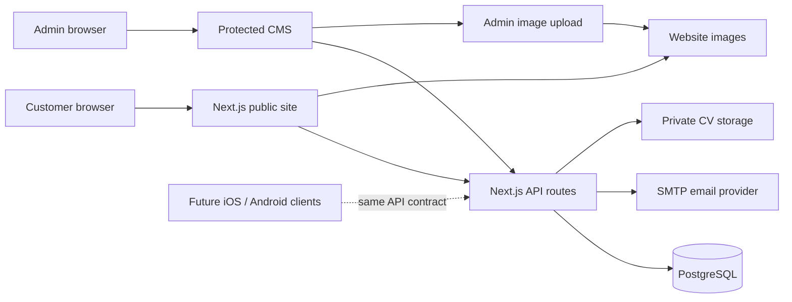

# Amigos Car Care — Full-Stack Technical Specification

**Hostinger database update:** MySQL 8.0.16+ and MariaDB 10.6+ are supported alongside PostgreSQL/PGlite. Import `data/schema.mysql.sql` for phpMyAdmin, set `DB_HOST`, `DB_PORT`, `DB_NAME`, `DB_USER`, and `DB_PASSWORD`, and follow `docs/HOSTINGER-MYSQL.md`. Database logic is shared in `scripts/database.mjs` and exposed to routes by `lib/db.ts`. The original `data/schema.sql` remains PostgreSQL-only.

## 1. Product scope

The platform contains a responsive public website for Amigos Car Care Qatar, a protected content management system, server-side API endpoints, an SQL data model, enquiry/career intake and aggregate website analytics. The current delivery is a web application that works on desktop and mobile browsers. A native iOS/Android client is a future client of the same API; native apps are not included in this web implementation.

## 2. Stack

| Layer | Current implementation | Production target |
|---|---|---|
| Web UI | Next.js App Router, React, TypeScript, responsive CSS | Same application, served over HTTPS/CDN |
| Backend | Next.js route handlers, Node.js runtime, Zod request validation | Same-origin API routes initially; extract to NestJS only if separate scaling or external API governance is needed |
| Database | MySQL/MariaDB and PostgreSQL adapters; embedded PGlite for local development | Hostinger MariaDB, MySQL 8.0.16+, or managed PostgreSQL 16+ with backups |
| Authentication | bcrypt password hash and opaque HttpOnly session cookie | Password sign-in with rate limits; secrets stored in platform secret manager |
| Email | Optional Nodemailer SMTP adapter for enquiry notifications | Verified transactional SMTP/email service; delivery alerts and suppression handling |
| Media | Existing provided photos under `public/assets`; admin raster upload to `public/uploads` locally | Private Azure Blob Storage (or equivalent) behind a CDN; malware scanning, metadata stripping and retention |
| Runtime/deploy | Node 20.9+, pnpm; local app starts on port 3000 | Container/app service in Qatar or nearby approved region, with staging and production environments |
| Native clients | Not part of the delivered web app | Expo React Native client calling the same versioned API and using the same identity/database policies |

This ZIP contains the full-stack implementation only. The earlier static prototype remains separate in the local workspace and is not required to run this app.

## 3. System overview

All web requests share one origin. The server checks the session cookie before running admin reads or changes. The public site gets only active services, active branches, published current offers and selected public settings. The admin API is not exposed to unauthenticated visitors.

## 4. Public website

- Responsive homepage with hero, service cards, a service/all-services view, quick booking/enquiry form, branch cards, current offer notices and contact links.
- Separate business enquiry and career application pages.
- Shared footer social links for the official Instagram, Facebook and LinkedIn profiles; external links open in a new tab with safe link attributes.
- Service and branch images are separate, editable image paths.
- Homepage appointment requests open a prefilled WhatsApp chat for the selected branch. Business, career and direct API enquiries are validated server-side and stored in the enquiry table.
- Career CV files are limited to PDF/DOC/DOCX and 8 MB and saved outside the public web directory. Authenticated admin downloads are served through an admin route.
- Business, career and booking submissions are stored in the enquiry inbox. Email notifications go to `info@amigoscarcare.com` when SMTP settings are configured. If delivery is unconfigured or fails, the submission remains stored for admin review; the response confirms receipt, not email delivery.

## 5. CMS and roles

The `/admin` CMS supports site settings, service cards, branch details, offer publication and a customer enquiry inbox. Image upload accepts JPG, PNG, WebP and AVIF up to 8 MB. The `/admin/analytics` view shows aggregate page views and most-viewed page paths.

The schema has `super_admin` and `content_editor` roles, but role-specific permissions and super-admin user provisioning are follow-on work; all active authenticated admins currently share CMS access. The first administrator is bootstrapped only from private environment variables (`ADMIN_INITIAL_USERNAME`, `ADMIN_INITIAL_EMAIL`, `ADMIN_INITIAL_PASSWORD`). Admin sign-in requires a valid username and password, with request rate limits. Passwords are bcrypt-hashed; session tokens are random, HttpOnly, SameSite Strict cookies and only token digests are persisted. Admin changes generate audit records.

Initial account provisioning needs to occur before deployment; do not deploy a shared or default password. Rotate the initial password after setup. Never commit `.env.local` or production secrets.

## 6. Data model

| Table | Use |
|---|---|
| `admins` | Admin identity, bcrypt password hash, role and active state |
| `admin_sessions` | Hashed opaque session token, expiry and admin reference |
| `login_challenges` | Legacy table retained for compatibility; no longer used for sign-in |
| `site_settings` | Public brand/contact/hero configuration |
| `services` | EN/AR titles, summaries, details, image path and display order |
| `branches` | EN/AR branch contacts, maps, hours, image and display order |
| `offers` | Bilingual offer content, validity dates and draft/published state |
| `enquiries` | Booking, business and career submissions and review state |
| `audit_events` | Admin content-change history |
| `analytics_page_views` | Aggregate page paths and timestamps, no identity, age, gender or precise location |

All primary IDs are UUIDs. Foreign keys cascade sessions/challenges when an admin is removed. Public content has explicit active/status filters. Enquiry retention and deletion rules must be set by the business before production launch.

## 7. API contract (current)

### Public

- `GET /api/health`
- `GET /api/public/site`
- `POST /api/public/analytics`
- `POST /api/public/enquiries`
- `POST /api/public/careers` (multipart CV form)

### Authentication

- `POST /api/auth/login`
- `POST /api/auth/verify`
- `GET /api/auth/session`
- `POST /api/auth/logout`

### Admin (session required)

- `GET/PUT /api/admin/site`
- `GET/POST/PUT/DELETE /api/admin/services`
- `GET/POST/PUT/DELETE /api/admin/branches`
- `GET/POST/PUT/DELETE /api/admin/offers`
- `GET /api/admin/enquiries`
- `GET /api/admin/enquiries?attachment={id}`
- `GET /api/admin/analytics`
- `POST /api/admin/upload`

Response bodies are JSON except image and CV file responses. The endpoint structure can later be versioned under `/api/v1` when a public native/mobile client is introduced.

## 8. Local setup

1. Use Node.js 20.9+ and pnpm.
2. Copy `.env.example` to `.env.local`; set unique admin credentials, a private admin email and a cryptographically random `AUTH_SECRET`.
3. Admin sign-in needs no email setup. Configure SMTP only for enquiry notification emails.
4. Run `pnpm install`, `pnpm db:init`, then `pnpm dev`; browse `http://localhost:3000`.
5. First access to `/admin` initializes seed content and the configured initial admin account.

Use `DATABASE_URL` for managed PostgreSQL. Set `DATABASE_SSL=true` only when the provider requires TLS and the certificate chain is trusted. The local PGlite files are development data and should not be copied to production.

## 9. Production readiness and phased delivery

Before public production use: deploy behind HTTPS; set up managed Postgres and backup/restore drills; configure and verify SMTP; configure durable private object storage for CVs and uploads; add malware scanning, lifecycle retention and admin-enforced enquiry retention; add rate limits/CAPTCHA for public forms; configure logging, uptime/error alerts and audit retention; use strong unique admin passwords and rotate credentials; add CSRF/origin validation and security headers/CSP; run database migrations and a staging smoke review. User analytics intentionally do not infer age, gender or identify visitors; collect optional demographics only with a clear lawful basis and explicit consent.

Suggested rollout: local development → staging with sample data → content review by Amigos → production DNS/HTTPS and secret setup → backup/monitoring validation → public launch. The included app is a working foundation and CMS, not a substitute for production infrastructure provisioning or business/security review.
