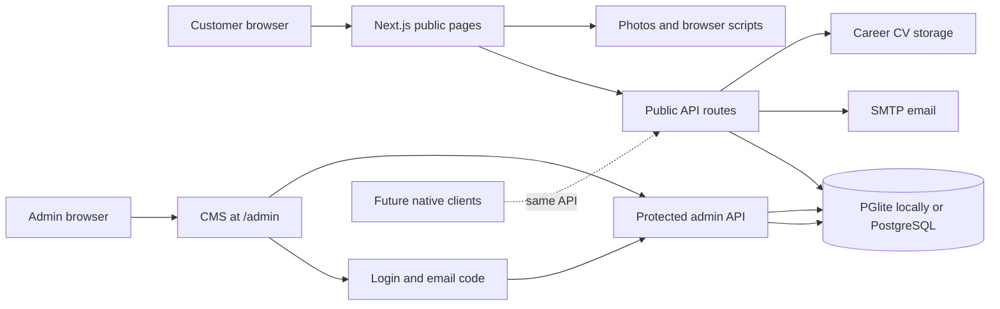

# Amigos Car Care Website and CMS Developer Handover

**Sign-in update:** Admin access now uses username and password only; SMTP is optional for enquiry notifications. The older Word/PDF copies still describe email verification.

**Hostinger update:** The current source also supports MySQL 8.0.16+ / MariaDB 10.6+. Use `data/schema.mysql.sql`, separate `DB_HOST`, `DB_PORT`, `DB_NAME`, `DB_USER`, and `DB_PASSWORD` values, and `docs/HOSTINGER-MYSQL.md`. `scripts/database.mjs` contains the shared adapter used by the web app and CLI tools. The Word/PDF copies predate this database update; use the current Markdown instructions for Hostinger.

**Purpose:** explain the delivered web application, its structure, configuration, local workflow, hosting procedure, and production boundaries so a development team can take ownership.

**Package:** full-stack web application · Next.js App Router · React · TypeScript · PostgreSQL-compatible database  
**Scope:** browser-based website and CMS. Native Android/iOS apps are not included.

## Executive overview

This package contains the Amigos Car Care Qatar public website and an authenticated CMS. The frontend and backend API run in one Next.js application. Local development uses an embedded PGlite database; a shared or production environment should use managed PostgreSQL, verified SMTP, HTTPS, durable private file storage, monitoring, and backups.

The ZIP includes source, the lockfile, media assets, SQL schema, documentation, and a safe `.env.example`. It deliberately excludes `.env.local`, database contents, private CV uploads, installed dependencies, and generated build output. Each developer creates private environment settings locally. Treat the current build as a working web foundation; complete the production items in this guide before public launch.

## What is included

- Responsive public pages for home, services, offers, branches, business enquiries, and careers.
- English/Arabic language toggle and right-to-left layout support.
- Service flow, search and category filters, service galleries, booking form, FAQ, and Amigos Assist guided help.
- Admin CMS for site settings, services, branches, offers, and enquiries, plus aggregate analytics.
- Server-side API routes, Zod validation, rate limiting, SQL schema, seed content, login challenge flow, and audit events.
- Separate service and branch imagery, official social profile links, and user-facing contact information.
- PostgreSQL-compatible schema and local PGlite mode.

## Architecture at a glance

### Main request flows

1. **Public content:** the browser loads Next.js pages. The home page calls `GET /api/public/site`, which seeds defaults if needed and returns active services, active branches, published offers, and public settings.
2. **Booking:** the form submits JSON to `/api/public/enquiries`. The API validates and stores the request. It attempts email notification if SMTP is fully configured; the database inbox remains the record of receipt.
3. **Business enquiry and career application:** multipart forms submit to `/api/public/business` and `/api/public/careers`. The API validates fields, stores the enquiry, stores career CVs privately, and attempts notification email.
4. **CMS:** an administrator signs in with username and password. The server sets an HttpOnly session cookie. The CMS calls protected `/api/admin/*` endpoints; changes are written to the database and audit log.
5. **Assets:** bundled photos and public scripts live in `public/assets`. CMS image uploads are currently written under `public/uploads`; career attachments are written under `data/private-cv`.

## Routes and pages

| URL | What it is for |
|---|---|
| `/` | Public home, services, booking, branches, FAQ, gallery, assistant and social links |
| `/service?slug=...` | Detail page for one service |
| `/offers` | Published offers and branch filter |
| `/business` | Business partner enquiry form |
| `/careers` | Career application form with CV upload |
| `/admin` | Admin login and content management; share only with authorized administrators |
| `/admin/analytics` | Privacy-friendly aggregate page-view reporting |
| `/api/health` | Service health response |

The social profiles are currently defined in `app/social-links.tsx`, not in the CMS. Update the profile URLs there if the official accounts change.

## Main files and what to change

| File or folder | Responsibility | Change it when… |
|---|---|---|
| `app/page.tsx` | Main public page, service flow, booking and section composition | Changing homepage layout, section order, or form behavior |
| `app/service/page.tsx` | Service detail page | Changing service detail presentation |
| `app/offers/page.tsx` | Public offers page | Changing offer display or filtering |
| `app/business/page.tsx` | Business enquiry form | Changing partner enquiry fields or copy |
| `app/careers/page.tsx` | Career form and CV input | Changing application fields or instructions |
| `app/admin/page.tsx` | CMS interface and sign-in experience | Changing admin editing UI |
| `app/admin/analytics/page.tsx` | Admin traffic metrics | Changing analytics presentation |
| `app/api/public/*/route.ts` | Public content, booking, business, careers, analytics | Changing public API behavior or validation |
| `app/api/auth/*/route.ts` | Password login, session, logout; retired email verification returns HTTP 410 | Changing authentication behavior |
| `app/api/admin/*/route.ts` | Authenticated CMS reads and changes | Changing content-management API behavior |
| `app/api/admin/[collection]/route.ts` | Shared collection API implementation | Updating service, branch, or offer CRUD rules |
| `app/social-links.tsx` | Instagram, Facebook, and LinkedIn URLs and icons | Changing official social profiles |
| `app/styles.css` | Main responsive design system and page styling | Updating core layout or visual styling |
| `public/assets/` | Brand mark, service/branch photos, Arabic and interaction scripts | Replacing approved photos or browser scripts |
| `public/uploads/` | CMS-uploaded public images in the current local-storage setup | Handling uploaded media; migrate before a multi-instance production deployment |
| `lib/db.ts` | Database connection and schema initialization | Changing PostgreSQL/PGlite connection behavior |
| `lib/auth.ts` | Session hashing, authorization helpers, and audit helper | Changing server-side admin security |
| `lib/seed.ts` | Default services, branches, migrations, initial admin bootstrap | Changing initial website content or data migrations |
| `lib/rate-limit.ts` | In-memory request rate limits | Changing abuse throttling; replace with shared storage in multi-instance deployment |
| `lib/admin-collection.ts` | Shared admin collection logic | Changing common CRUD implementation |
| `data/schema.sql` | Tables, constraints, indexes, and schema adjustments | Changing database structure; use a reviewed migration for existing databases |
| `scripts/run-next.mjs` | Starts Next.js on `PORT` and binds to `0.0.0.0` | Changing the app server entry point |
| `scripts/init-db.mjs` | Applies schema to local or configured PostgreSQL database | Initializing a new database |
| `scripts/seed-admin.mjs` | Creates the first admin account from private environment values | Provisioning a first administrator |
| `next.config.ts` | Next.js settings and baseline security headers | Changing framework or response-header configuration |
| `package.json`, `pnpm-lock.yaml` | Scripts, dependencies, and exact resolved package tree | Updating packages; commit both files together |
| `.env.example` | Safe starter configuration with placeholders only | Adding or documenting environment variables |
| `.env.local` | Developer-specific local secrets; excluded from sharing | Local setup only; never commit or send to the team |
| `.gitignore` | Excludes secrets, generated files, private database and CV data | Protecting new local-only directories |
| `docs/` | Handover, configuration notes, and assistant safety reference | Updating developer documentation |

## API surface

| Route | Methods | Access and purpose |
|---|---|---|
| `/api/public/site` | `GET` | Public active content and settings |
| `/api/public/enquiries` | `POST` | Booking and general enquiry submission |
| `/api/public/business` | `POST` | Business enquiry form, optional file, and notification attempt |
| `/api/public/careers` | `POST` | Career application, private CV storage, and notification attempt |
| `/api/public/analytics` | `POST` | Aggregate page-view event |
| `/api/auth/login` | `POST` | Validate password and issue email challenge |
| `/api/auth/verify` | `POST` | Verify code and create session |
| `/api/auth/session` | `GET` | Check current administrator session |
| `/api/auth/logout` | `POST` | End administrator session |
| `/api/admin/site` | `GET`, `PUT` | Read and update site settings; authenticated |
| `/api/admin/services` | `GET`, `POST`, `PUT`, `DELETE` | Manage services; authenticated |
| `/api/admin/branches` | `GET`, `POST`, `PUT`, `DELETE` | Manage branches; authenticated |
| `/api/admin/offers` | `GET`, `POST`, `PUT`, `DELETE` | Manage offers; authenticated |
| `/api/admin/enquiries` | `GET` | Read enquiries and authorized attachment downloads |
| `/api/admin/analytics` | `GET` | Aggregate analytics; authenticated |
| `/api/admin/upload` | `POST` | Upload website image; authenticated |

## Data and files

`data/schema.sql` defines administrators, sessions, login challenges, settings, services, branches, offers, enquiries, audit events, analytics, and migration tracking. `lib/seed.ts` inserts default public content and applies guarded one-time content migrations. IDs are UUIDs; service/branch ordering uses `sort_order`; public offers must be published and within their dates.

| Data | Current local location | Production direction |
|---|---|---|
| Database | `data/local-db/` (PGlite) when `DATABASE_URL` is blank | Managed PostgreSQL with TLS, automated backups, and restore drills |
| Public photos | `public/assets/` and `public/uploads/` | Durable object storage/CDN; prevent loss across deployments |
| Career CVs | `data/private-cv/`, outside the public site | Private object storage, restricted downloads, malware scan, retention policy |
| Secrets | `.env.local` | Host secret manager or protected environment variables |

The current CMS role field includes `super_admin` and `content_editor`, but role-specific feature permissions are not implemented: active authenticated admins currently share the CMS access level. Plan granular access control before inviting content-only staff.

## Configuration

Start from the included `.env.example`; create a local `.env.local` that is never shared. The full settings guide is `docs/ENVIRONMENT-CONFIGURATION.md`.

| Variable | Required when | Notes |
|---|---|---|
| `DATABASE_URL` | Using managed PostgreSQL | Leave empty for local PGlite. Contains credentials; keep private. |
| `DATABASE_SSL` | Managed database requires TLS | Set `true` only with a trusted provider certificate. |
| `PORT` | Hosting platform assigns a port | Defaults to `3000`; the server binds to `0.0.0.0`. |
| `ADMIN_INITIAL_USERNAME`, `ADMIN_INITIAL_EMAIL`, `ADMIN_INITIAL_PASSWORD` | Creating the initial admin | Use a private admin email and new unique password; never commit these values. |
| `AUTH_SECRET` | Always in production | Random secret of at least 32 characters; use a secret manager. |
| `MAIL_MODE` | Always | `console` for local OTP output only; `smtp` for production OTP email. |
| `SMTP_HOST`, `SMTP_PORT`, `SMTP_USER`, `SMTP_PASS`, `SMTP_FROM` | Optional enquiry notifications | Use a verified sender. The code enables implicit TLS on port 465; use the provider-recommended port. |

The template deliberately avoids unused settings. For example, the current app does not read `NEXT_PUBLIC_SITE_URL` or `SMTP_SECURE`; the mail transport derives TLS mode from the port.

## Local development SOP

1. Install Node.js 20.9 or newer and an approved pnpm version. Open a terminal in the extracted project root.
2. Create private config from the sample: `Copy-Item .env.example .env.local` in PowerShell or `cp .env.example .env.local` on macOS/Linux.
3. Edit `.env.local`. Choose a new admin username, private email and unique password. Generate `AUTH_SECRET` with Node: `node -e "console.log(require('node:crypto').randomBytes(48).toString('base64url'))"`.
5. Install the locked dependencies: `pnpm install --frozen-lockfile`.
6. Check TypeScript: `pnpm run check`.
7. Create local tables: `pnpm db:init`.
8. Start development: `pnpm dev`, then open `http://localhost:3000`. The server must remain running while testing.
9. Check health at `http://localhost:3000/api/health`; open `/admin` and sign in with your username and password.

Seeded services and branches are inserted idempotently when public content is first requested. `pnpm db:seed` can create an initial admin account explicitly after schema setup. Do not share a local database folder to move content; use a controlled database migration/export process.

## Content editing SOP

Use `/admin` after password sign-in. Change services, branches, offers, or public settings there. An offer must be published and inside its active dates to appear. Uploads under `public/uploads` are public website imagery; never upload private application documents there. Review the public page after every content change, including mobile and Arabic display.

Some things are code-controlled rather than CMS-controlled: social profile URLs are in `app/social-links.tsx`; navigation and section structure are in page components; translations are in `public/assets/arabic.js`; seeded defaults are in `lib/seed.ts`. Make code changes in the source and commit them. CMS edits are saved in the database, not as edits to source files.

## Hosting and release SOP

### Prepare staging

1. Choose a Node.js application host that supports the Node version in this guide and a persistent runtime. Configure a managed PostgreSQL database and verified SMTP account.
2. Connect a private source repository or upload the handoff package. Use the included `pnpm-lock.yaml`; install with `pnpm install --frozen-lockfile`.
4. Build with `pnpm run check` and `pnpm run build`; start with `pnpm start` (which runs `scripts/run-next.mjs`). Configure the platform health check to `GET /api/health`.
5. Initialize schema with `pnpm db:init`, then create the initial admin with `pnpm db:seed` using the same production environment. Verify login and email delivery before inviting users.
6. Review service and branch content, test booking/business/career forms, check the admin inbox and notification flags, and verify all images, social links, Arabic layout, and mobile breakpoints.

### Production launch gate

- Use HTTPS with a valid domain and secure cookies; do not publish a temporary tunnel as production hosting.
- Complete durable object-storage integration for `public/uploads` and private CVs before using ephemeral or multi-instance hosting. Current file storage is local to one app instance and can be lost on redeploy or unavailable to another instance.
- Set automated encrypted database backups and complete a restore drill. Establish enquiry, audit, and CV retention/deletion periods with the business.
- Configure SMTP sender/domain verification, delivery monitoring, and a process for failures. A form response can confirm database receipt even if notification email fails; staff must monitor `/admin` enquiries.
- Add a shared rate limiter for multi-instance hosting; current in-memory rate limits are per process.
- Review role permissions, admin recovery, CSRF/origin protections, security headers/CSP, logging, uptime monitoring, and incident response.
- Test the production build in staging, record rollback steps, then deploy the approved release.

## Security and privacy boundaries

- Never commit or email `.env.local`, passwords, `AUTH_SECRET`, SMTP credentials, database URLs, local database files, or CV uploads.
- `.gitignore` excludes `.env.*` (except `.env.example`), `data/local-db/`, `data/private-cv/`, and uploaded file contents. Check exclusions before every archive.
- The admin password is bcrypt-hashed. Email codes are short-lived and limited to five attempts. Session tokens are random, stored as hashes in the database, and issued as HttpOnly, SameSite cookies; production cookies add Secure.
- Analytics stores aggregate page paths and times only; it does not report visitor names, age, gender, or precise location.
- Forms contain personal data. Limit access, define retention, and use private storage for CVs. Do not claim email delivery until SMTP is configured and the delivery state is checked.
- The Amigos Assist chatbot is a guided client-side automotive help flow, not a generative AI model. Preserve its safety guidance; do not promise a diagnosis.

## Troubleshooting

| Symptom | First checks |
|---|---|
| `localhost:3000` refuses connection | Start `pnpm dev`; keep the terminal open; confirm `PORT` is 3000 and no other process owns it. |
| Admin OTP not arriving locally | `MAIL_MODE=console` prints it in the running server terminal. |
| Admin sign-in unavailable | Check the database connection, account active state, password, and AUTH_SECRET. SMTP is not required. |
| Email did not arrive for a form | Check `/admin` enquiries and notification status; database receipt and email notification are separate outcomes. |
| Content changes disappear after deploy | The default PGlite database or local media path may be ephemeral; configure managed database and durable storage. |
| Uploaded CV missing after redeploy | Current CV storage is local to the app; implement persistent private object storage and backups before production. |
| Services or branches are missing | Check `/api/public/site`, database availability, `active` values, and seed logs. |
| Arabic does not display correctly | Check `public/assets/arabic.js`, browser cache, and RTL styles; verify language switch in a clean session. |

## Release checklist

- [ ] Source changes reviewed and locked dependency file preserved.
- [ ] `.env.local`, local DB, CVs, and secrets excluded from the handoff.
- [ ] TypeScript check and production build succeed.
- [ ] Public routes, APIs, images, links, Arabic, and mobile layout reviewed.
- [ ] Admin password sign-in, CMS updates, and access boundaries reviewed.
- [ ] Form storage and email notification tested independently.
- [ ] Managed database backups and restore verified.
- [ ] Durable image and private-CV storage ready.
- [ ] HTTPS, monitoring, retention, and rollback are documented.
- [ ] Business approves website copy, branch details, contact data, offers, and launch.

## Ongoing operating cadence

| When | Team action |
|---|---|
| Each deployment | Check `/api/health`, public pages, booking and enquiry forms, admin sign-in, email delivery, and uploaded media. Keep the previous release available for rollback. |
| Daily during launch week | Review `/admin` enquiries, notification failures, uptime, and error logs. Confirm high-priority business enquiries reach the team. |
| Weekly | Confirm database backup completion, test a sample restore on a safe staging copy, review upload capacity, and clear the enquiry queue. |
| Monthly | Review admin access and inactive users, check retention/deletion schedules, rotate credentials when required, and review dependency/security updates. |

If a release fails, route traffic back to the last known good release and inspect logs before retrying. Do not restore a database backup over newer customer enquiries without an approved recovery plan.

## Ownership summary

The developers own source code, API behavior, deploy configuration, database migrations, and security controls. Authorized content administrators own published copy, offers, and imagery entered in the CMS. Keep source changes and CMS database content distinct, back up both code and data, and promote changes through staging before production.
